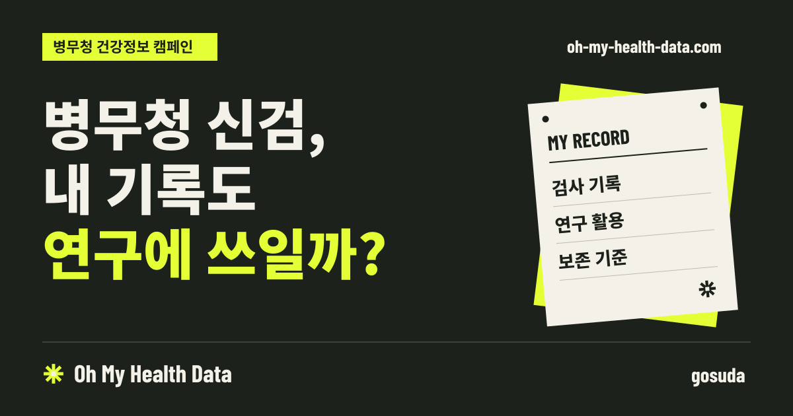
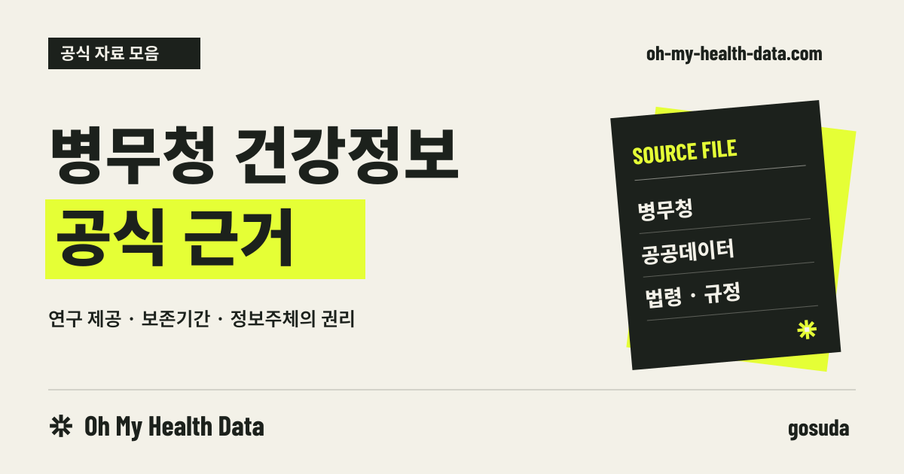

# SEO 적용 리뷰

대표 도메인은 `https://oh-my-health-data.com`이다. 공개 페이지 두 개에 SEO 설정을 적용하고 정적 빌드와 브라우저 이동을 검증했다. 이 문서는 적용한 항목과 배포 환경에서 마무리할 항목을 정리한다.

## 적용 항목

| 항목 | 적용 내용 |
| --- | --- |
| robots.txt | 공개 URL 크롤링 허용, 절대 URL 사이트맵 명시. CSS·JS 자산은 차단하지 않음 |
| sitemap.xml | 홈과 `/sources/`의 대표 URL만 수록. 해시·쿼리·404 및 부정확한 변경일 제외 |
| canonical | 각 페이지의 HTTPS 대표 URL을 하나씩 출력 |
| 검색 제목·설명 | 페이지별 제목·설명 구분. 근거 페이지 제목에 병무청·건강정보·연구·보존기간 명시 |
| 공유 메타데이터 | OG 제목·설명·URL·이미지·크기·대체문구·언어·사이트명, Twitter 큰 이미지 카드 |
| OG 이미지 | 홈·근거 페이지 각각 1200×630 PNG. 폰트를 경로로 변환한 SVG 원본과 재생성 스크립트 포함 |
| 구조화 데이터 | WebSite, 게시 주체 gosuda Organization, WebPage/CollectionPage, ImageObject. 근거 페이지에는 BreadcrumbList 추가 |
| 파비콘 | 사이트의 별 마크로 SVG·48px PNG·180px Apple 아이콘 통일. 캠페인 이미지 512px PNG 추가 |
| 오류 페이지 | 정적 `404.html` 및 클라이언트 오류 화면에 noindex. 정상 페이지의 canonical·공유 태그를 오류 화면에 남기지 않음 |
| 자산·공유 경로 | 중첩 오류 주소에서도 CSS·아이콘이 열리도록 루트 절대경로 사용. 공유 버튼은 접속 중인 로컬·미리보기 호스트 대신 대표 도메인 사용 |
| 글꼴 | 영문 표시용 Barlow는 사용하는 Latin 문자셋만 포함. 기존 한글 가변 폰트·swap 유지 |

중앙 설정은 `src/lib/site.ts`와 `src/lib/seo.ts`, 공통 출력은 `src/lib/Seo.svelte`에 있다. 고정된 공공 캠페인 페이지의 실제 내용에 맞는 schema만 사용하며, 검색 기능·후기 점수·의료기관 같은 존재하지 않는 속성은 넣지 않았다.

## 리뷰할 검색 결과와 공유 이미지

| 페이지 | 검색 제목 | 대표 URL |
| --- | --- | --- |
| 홈 | 병무청 신검, 내 기록도 연구에 쓰일까? \| Oh My Health Data | `https://oh-my-health-data.com/` |
| 공식 근거 | 병무청 건강정보 연구·보존기간 공식 근거 \| Oh My Health Data | `https://oh-my-health-data.com/sources/` |

홈 공유 이미지:

공식 근거 공유 이미지:

SVG 원본과 PNG는 저장소에 포함하므로 일반 사이트 빌드에는 이미지 생성 도구가 필요 없다. 문구·레이아웃을 바꿀 때의 [이미지 재생성 방법](SEO_IMAGES.md)은 별도로 정리했다.

## 검증

- `npm run check`: 오류·경고 0개.
- `npm run build`: 정적 페이지·사이트맵·robots·이미지·404 출력 성공.
- `python3 -B scripts/test_seo.py`: SEO 출력 검사 6개 통과. canonical 중복, 메타태그 누락, JSON-LD 관계, 이미지 크기, 사이트맵의 페이지 누락, 404 색인 설정을 검증.
- 기존 문안 생성·패키징 테스트 19개 통과.
- 브라우저에서 홈 → 근거 → 홈 이동 시 title·canonical·OG 이미지·JSON-LD가 중복 없이 교체되는 것을 확인.
- 중첩 미존재 주소는 noindex 오류 화면을 표시하며 홈 복귀 후 정상 메타데이터를 복원.
- 로컬 프로덕션 미리보기에서 홈·근거·robots·사이트맵·OG 이미지는 HTTP 200, 최상위·중첩 미존재 주소는 HTTP 404 확인.

## 배포 환경에서 마무리할 항목

1. `oh-my-health-data.com`의 DNS와 HTTPS 연결.
2. HTTP·www 등 사용 중인 별칭을 대표 HTTPS 호스트로 영구 리디렉션. `/sources`의 `/sources/` 정규화 확인.
3. 정적 호스트가 없는 주소에 `404.html`을 HTTP 404 상태로 제공하도록 설정. 모든 주소를 홈으로 보내는 200 SPA fallback은 사용하지 않음.
4. 미리보기 호스트를 공개 운영한다면 해당 호스트의 인증 또는 noindex 정책 적용. 운영 도메인에는 색인을 차단하는 응답 헤더가 없어야 함.
5. Google Search Console·네이버 서치어드바이저 소유권 확인, 사이트맵 제출과 실제 색인 점검.
6. 운영 URL로 PageSpeed·모바일 사용자 경험과 카카오톡 등 공유 미리보기 확인. 로컬 코드 검사로 실사용 성능이나 검색 노출을 보장하지 않음.

## 참고

- [Google robots.txt 안내](https://developers.google.com/search/docs/crawling-indexing/robots/intro)
- [canonical 지정](https://developers.google.com/search/docs/crawling-indexing/consolidate-duplicate-urls)
- [사이트명 구조화 데이터](https://developers.google.com/search/docs/appearance/site-names)
- [Open Graph 규격](https://ogp.me/)
